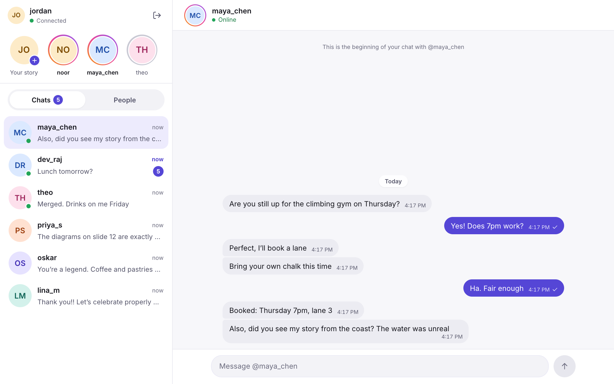
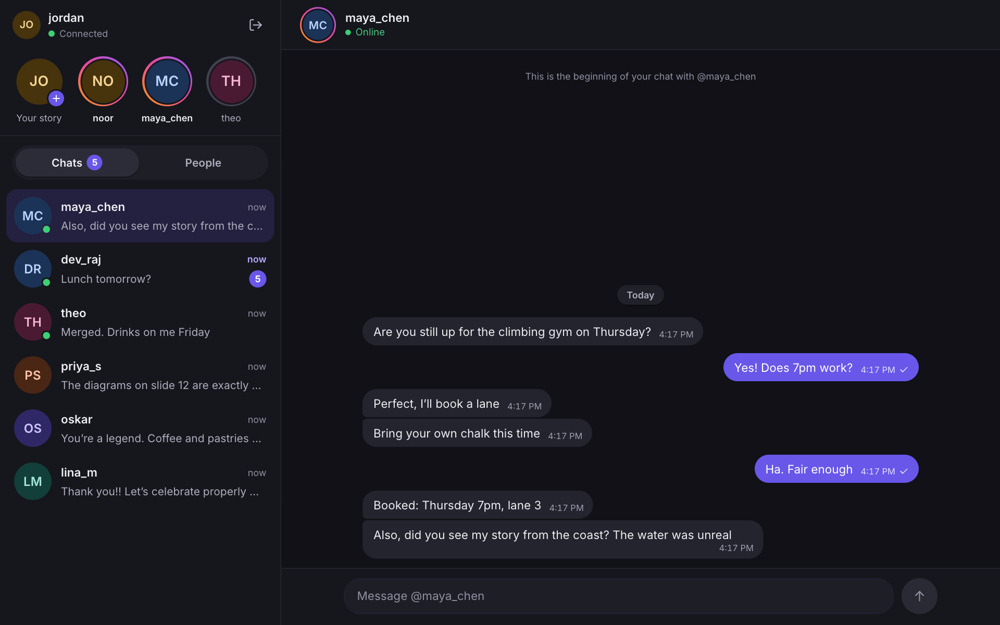
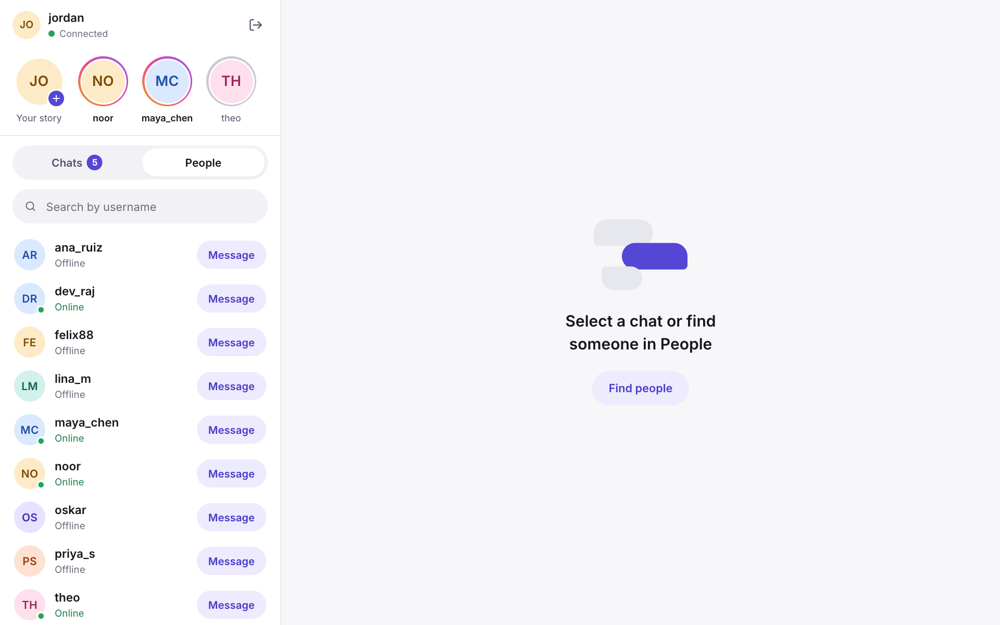
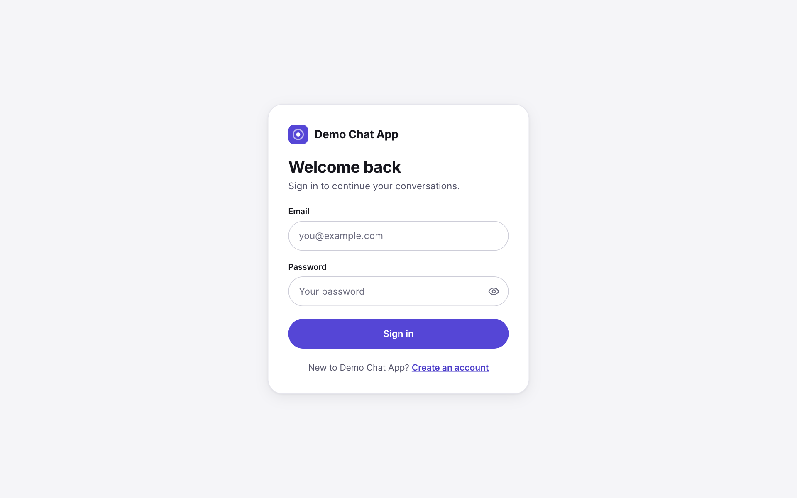
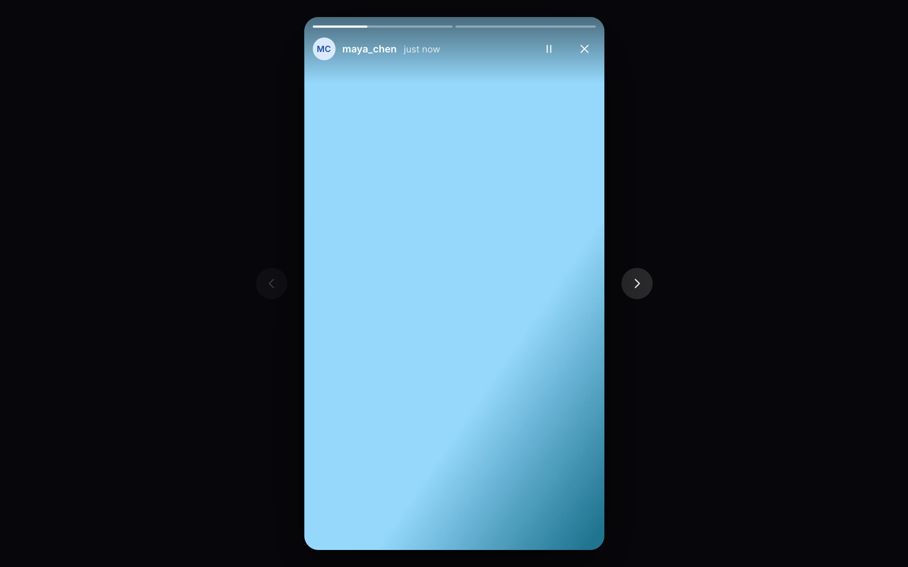
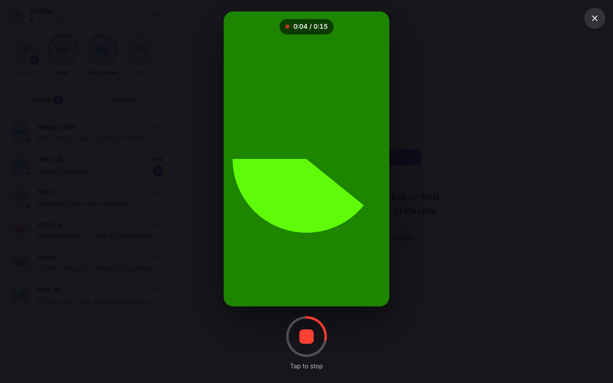
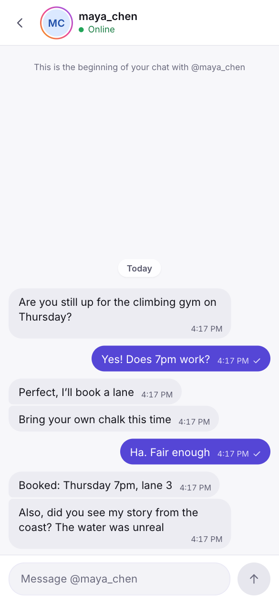

# Demo Chat App

Мессенджер 1-на-1 с доставкой сообщений в реальном времени и видео-историями (stories).

**Стек:** NestJS · SvelteKit · MongoDB · Socket.io · Docker Compose



| | | |
|---|---|---|
|  |  |  |
|  |  |  |

## Возможности

- **Авторизация** — регистрация (email, username, пароль) и вход по JWT; закрыты все API-роуты, кроме входа и регистрации, и WebSocket-подключение. Видео отдаются без токена, по случайным uuid-именам.
- **Диалоги** — список своих диалогов с последним сообщением и счётчиком непрочитанных; создание диалога с любым пользователем.
- **Сообщения в реальном времени** — отправка через WebSocket с подтверждением, мгновенная доставка собеседнику, повторная отправка при сбое без дубликатов, догрузка истории.
- **Пользователи** — список всех пользователей, поиск по username, статус онлайн.
- **Stories** — запись видео с веб-камеры (до 15 секунд), лента пользователей с активными историями, просмотр с прогрессом и переходами, автоудаление через 24 часа.
- **UX** — скелетоны загрузки, пустые состояния, ошибки с Retry, баннер переподключения, светлая и тёмная тема (по системной), мобильная раскладка.

## Быстрый старт (Docker)

Нужны Docker и Docker Compose.

```bash
docker compose up --build
```

Откройте http://localhost:8080 и зарегистрируйтесь. Чтобы проверить обмен сообщениями, зарегистрируйте второго пользователя в окне инкогнито или другом браузере, найдите его во вкладке **People** и нажмите **Message**.

Запись stories требует доступа к камере. Браузеры дают его только на `localhost` или по HTTPS.

### Переменные окружения

Все переменные необязательные. Их можно задать в `.env` рядом с `docker-compose.yml` (пример — `.env.example`).

| Переменная | По умолчанию | Назначение |
|---|---|---|
| `APP_PORT` | `8080` | Порт приложения на хосте |
| `MONGO_PORT` | `27017` | Порт MongoDB на хосте (доступен только с `127.0.0.1`) |
| `JWT_SECRET` | `change-me-in-production` | Секрет подписи JWT |
| `JWT_EXPIRES_IN` | `7d` | Время жизни токена |

Если порт уже занят:

```bash
APP_PORT=8090 MONGO_PORT=27018 docker compose up --build
```

## Локальная разработка

Нужен Node.js 22+.

**1. MongoDB**

```bash
docker compose up -d mongo
```

**2. Backend** (http://localhost:3000/api)

```bash
cd backend
npm ci
npm run start:dev
```

| Переменная | По умолчанию |
|---|---|
| `PORT` | `3000` |
| `MONGO_URI` | `mongodb://127.0.0.1:27017/chat` |
| `JWT_SECRET` | `dev-secret-change-me` (в production обязателен) |
| `JWT_EXPIRES_IN` | `7d` |
| `UPLOAD_DIR` | `uploads` |

**3. Frontend** (http://localhost:5173)

```bash
cd frontend
npm ci
npm run dev
```

Vite проксирует `/api`, `/media` и `/socket.io` на backend. Адрес backend можно сменить переменной `API_URL` (по умолчанию `http://localhost:3000`).

## Тесты и проверки

```bash
cd backend
npm test
```

38 e2e-тестов на поднятом приложении: in-memory MongoDB (`mongodb-memory-server`), HTTP через supertest, реальные сокеты через socket.io-client. Покрыты auth, users, диалоги и сообщения, WebSocket-gateway (доставка, права, presence, идемпотентность, истечение токена) и stories (загрузка, лента, просмотры, очистка). При первом запуске скачивается бинарник MongoDB.

```bash
cd frontend
npm test
npm run check
```

20 unit-тестов (Vitest) на утилиты и редьюсеры stores, плюс проверка типов через `svelte-check`.

## Структура проекта

```
backend/                  NestJS API
  src/auth/               регистрация, вход, глобальный JWT guard
  src/users/              пользователи и поиск
  src/conversations/      диалоги, непрочитанные
  src/messages/           сообщения, пагинация, отправка
  src/chat/               WebSocket gateway
  src/realtime/           presence и рассылка событий
  src/stories/            загрузка видео, лента, очистка
  src/common/             фильтр ошибок, валидация, декораторы
  test/                   e2e-тесты
frontend/                 SvelteKit SPA
  src/routes/             (auth)/login, register · (app)/, chat/[id]
  src/lib/stores/         svelte/store: auth, conversations, messages, users, stories, …
  src/lib/api/            HTTP-клиент
  src/lib/session.ts      жизненный цикл сокета
  src/lib/components/     UI-компоненты
  src/styles/             дизайн-токены и стили
  nginx.conf              раздача SPA и прокси на backend
shared/contracts.d.ts     общие типы API и WebSocket-событий
docker-compose.yml        mongo + backend + frontend
```

## API

Все REST-роуты с префиксом `/api` и заголовком `Authorization: Bearer <token>`, кроме `register` и `login`.

| Метод | Путь | Описание |
|---|---|---|
| `POST` | `/auth/register` | `{ email, username, password }` → `{ accessToken, user }` |
| `POST` | `/auth/login` | `{ email, password }` → `{ accessToken, user }` |
| `GET` | `/auth/me` | текущий пользователь |
| `GET` | `/users?search=&limit=` | пользователи, кроме себя |
| `GET` | `/conversations` | мои диалоги |
| `POST` | `/conversations` | `{ userId }` → диалог (существующий или новый) |
| `POST` | `/conversations/:id/read` | отметить прочитанным |
| `GET` | `/conversations/:id/messages?before=&limit=` | `{ items, hasMore }`, курсорная пагинация |
| `POST` | `/conversations/:id/messages` | `{ text, clientId? }` |
| `GET` | `/stories` | активные истории по пользователям |
| `POST` | `/stories` | multipart: `video`, `durationMs` |
| `POST` | `/stories/:id/view` | отметить просмотренной |
| `GET` | `/media/stories/:file` | видеофайл |

Ошибки возвращаются в формате `{ statusCode, message, error, field? }`.

**WebSocket** (Socket.io, токен в `auth: { token }` при подключении):

| Направление | Событие | Данные |
|---|---|---|
| клиент → сервер | `message:send` | `{ conversationId, text, clientId }` → ack `{ ok, message }` или `{ ok: false, error }` |
| клиент → сервер | `conversation:read` | `{ conversationId }` |
| сервер → клиент | `message:new` | `{ message, conversation }` |
| сервер → клиент | `presence` | `{ userId, online }` |
| сервер → клиент | `story:new` | `{ userId }` |

## Общие типы

Контракт между backend и frontend описан в одном файле, [`shared/contracts.d.ts`](shared/contracts.d.ts):
- формы ответов (`UserDto`, `MessageDto`, `ConversationDto`, `StoryDto`, …);
- тела запросов (`RegisterRequest`, `SendMessageRequest`, …) и формат ошибки;
- карты WebSocket-событий `ClientToServerEvents` и `ServerToClientEvents` вместе с payload и ack.

Обе стороны подключают файл как `@chat/contracts` (alias в `backend/tsconfig.json` и `frontend/svelte.config.js`) и импортируют из него только типы (`import type`), поэтому в сборку он не попадает. Классы валидации на backend объявлены через `implements RegisterRequest` и т.п. Socket.io типизирован на обеих сторонах: `Server<ClientToServerEvents, ServerToClientEvents>` на backend, `Socket<ServerToClientEvents, ClientToServerEvents>` на клиенте. Если поменять поле или событие только на одной стороне, сломается `tsc` или `svelte-check`.

Общий файл типов — это вариант «для практики»: он простой и покрывает и REST, и WebSocket. В реальном проекте REST-часть разумнее синхронизировать через OpenAPI: `@nestjs/swagger` генерирует схему из DTO, `openapi-typescript` или `orval` генерируют из неё клиентские типы и SDK, а заодно появляется Swagger UI. WebSocket-события OpenAPI не описывает, для них остаются общие типы или AsyncAPI.

## Решения и ограничения

- **Доставка сообщений.** Клиент показывает сообщение сразу и заменяет его подтверждённым по `clientId`. Повтор с тем же `clientId` не создаёт дубликат (уникальный индекс). При переподключении клиент заново загружает диалоги и открытый чат, поэтому сообщения, пришедшие во время обрыва, не теряются.
- **Stories.** Видео хранится на диске (docker volume) под случайными uuid-именами, без перекодирования. Удаление через 24 часа делают TTL-индекс MongoDB и фоновая задача, которая удаляет файлы.
- **Токен.** Access-JWT без refresh, хранится в `localStorage`. Сокет отключается, когда истекает срок токена.
- **Масштабирование.** Статус онлайн хранится в памяти процесса, рассчитано на один экземпляр backend.
- **Вне объёма** (по ТЗ): групповые чаты, файлы в чате, редактирование и удаление сообщений, push-уведомления, обработка видео на сервере.
